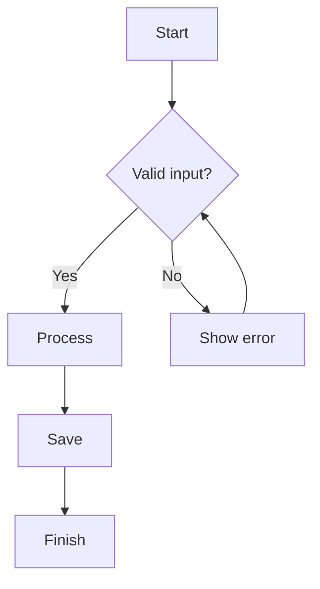
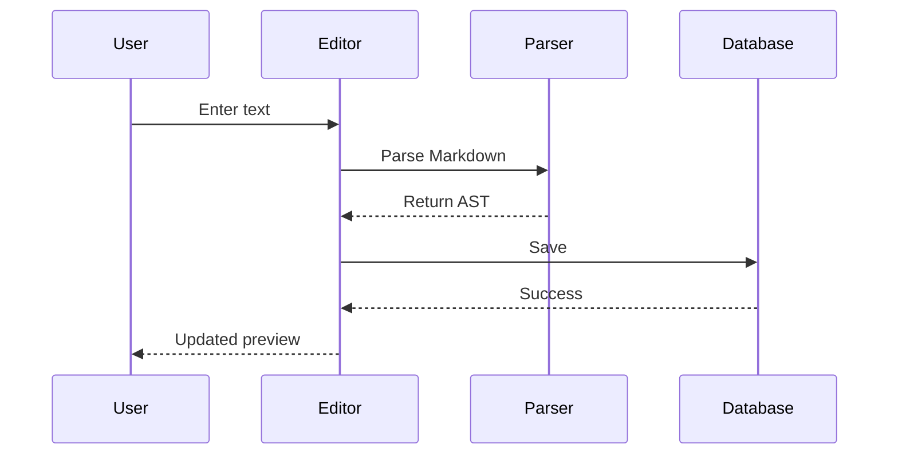
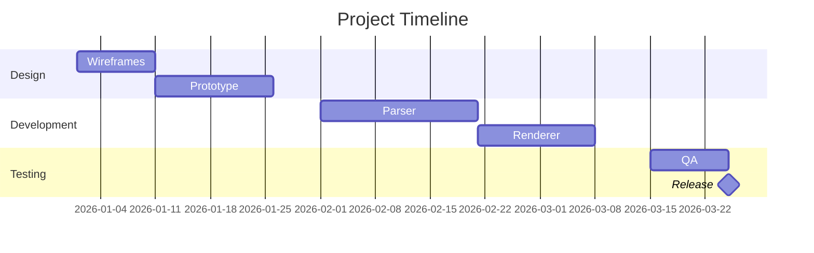

---
title: "Ultimate Markdown Editor Stress Test"
version: "2.0.0"
author: "OpenAI"
date: "2026-11-19"
tags: [markdown, stress-test, editor, performance, edge-cases]
config:
  enabled: true
  nested:
    level: 3
    options: [alpha, beta, gamma]
---

# Ultimate Markdown Stress Test

> A comprehensive document designed to stress-test Markdown editors,
> parsers, syntax highlighters, renderers, and document serialization.

---

# 1. Typography

Normal paragraph with **bold**, *italic*, ***bold italic***,
~~strikethrough~~, `inline code`, and [a hyperlink](https://example.com).

Escaped formatting: \*not italic\*, \_not italic\_, \`not code\`.

Superscript: E = mc<sup>2</sup>

Subscript: H<sub>2</sub>O

Highlighted: <mark>Important information</mark>

Keyboard: <kbd>CTRL</kbd> + <kbd>SHIFT</kbd> + <kbd>P</kbd>

---

# 2. Heading Hierarchy

## Level 2

### Level 3

#### Level 4

##### Level 5

###### Level 6

## Heading with **bold** and *italic*

## Heading with `inline code`

---

# 3. Lists

## Unordered

- Item A
- Item B
  - Nested B1
  - Nested B2
    - Nested B2.1
      - Nested B2.1.1
        - Deep nesting
- Item C

## Ordered

1. First
2. Second
3. Third
   1. Sub-item A
   2. Sub-item B
      1. Deep item
      2. Deep item
4. Fourth

## Mixed

1. Main item
   - Unordered child
   - Another child
     1. Ordered grandchild
     2. Another grandchild
        - Deep unordered child
2. Second main item

## Task lists

- [ ] Not completed
- [x] Completed
- [ ] In progress
  - [x] Finished subtask
  - [ ] Unfinished subtask
- [X] Uppercase X

---

# 4. Tables

## Standard table

| ID | Name | Age | Status |
|---:|:-----|----:|:------:|
| 1 | Alice | 28 | Active |
| 2 | Bob | 34 | Inactive |
| 3 | Charlie | 42 | Active |
| 4 | Diana | 25 | Pending |

## Complex table

| Feature | Markdown | HTML | Supported |
|:--------|:--------:|:----:|----------:|
| Bold | **Yes** | `<b>` | 100% |
| Italic | *Yes* | `<i>` | 100% |
| Code | `Yes` | `<code>` | 100% |
| Strike | ~~Yes~~ | `<del>` | 100% |
| Links | [Yes](https://example.com) | `<a>` | 100% |

## Wide table

| A | B | C | D | E | F | G | H | I | J |
|---|---|---|---|---|---|---|---|---|---|
| 1 | 2 | 3 | 4 | 5 | 6 | 7 | 8 | 9 | 10 |
| 11 | 12 | 13 | 14 | 15 | 16 | 17 | 18 | 19 | 20 |

## Empty cells

| A | B | C |
|---|---|---|
|   | 1 |   |
| 2 |   | 3 |
|   |   |   |

---

# 5. Blockquotes

> Simple blockquote.

> Multiline blockquote.
>
> Second paragraph.
>
> **Bold text inside quote.**

> Nested blockquote:
>
> > First nesting level.
> >
> > > Second nesting level.
> > >
> > > > Third nesting level.

> Quote containing a list:
>
> - One
> - Two
> - Three

---

# 6. Code Blocks

## JavaScript

```javascript
const config = {
  name: "Stress Test",
  enabled: true,
  retries: 5,
  features: ["markdown", "tables", "math", "code"],
};

function fibonacci(n) {
  if (n <= 1) return n;
  return fibonacci(n - 1) + fibonacci(n - 2);
}

console.log(fibonacci(10));
```

## TypeScript

```typescript
interface User {
  id: number;
  name: string;
  active: boolean;
}

class UserService {
  private users: User[] = [];

  add(user: User): void {
    this.users.push(user);
  }

  find(id: number): User | undefined {
    return this.users.find(user => user.id === id);
  }
}
```

## Python

```python
from dataclasses import dataclass
from typing import Optional

@dataclass
class User:
    id: int
    name: str
    email: Optional[str] = None

def process_users(users):
    return [
        f"{user.id}: {user.name}"
        for user in users
    ]

users = [
    User(1, "Alice"),
    User(2, "Bob"),
]

print(process_users(users))
```

## Rust

```rust
use std::collections::HashMap;

fn main() {
    let mut scores = HashMap::new();

    scores.insert("Alice", 100);
    scores.insert("Bob", 85);

    for (name, score) in &scores {
        println!("{name}: {score}");
    }
}
```

## SQL

```sql
SELECT
    users.name,
    COUNT(orders.id) AS order_count,
    SUM(orders.total) AS revenue
FROM users
LEFT JOIN orders
    ON users.id = orders.user_id
WHERE users.active = TRUE
GROUP BY users.id, users.name
ORDER BY revenue DESC;
```

## JSON

```json
{
  "application": {
    "name": "Markdown Stress Test",
    "version": "2.0.0",
    "enabled": true,
    "features": [
      "editing",
      "rendering",
      "serialization"
    ],
    "metadata": null
  }
}
```

## YAML

```yaml
application:
  name: markdown-test
  environment: development
  services:
    - name: frontend
      port: 3000
      enabled: true
    - name: backend
      port: 8080
      enabled: true
  database:
    host: localhost
    port: 5432
```

## Bash

```bash
#!/usr/bin/env bash

set -euo pipefail

PROJECT="markdown-test"

echo "Building ${PROJECT}..."

for file in ./src/*.md; do
    echo "Processing: ${file}"
done

echo "Build complete."
```

---

# 7. Mathematics

Inline equation: \(E = mc^2\)

Inline fraction: \(\frac{a+b}{c+d}\)

Gaussian integral:

$$
\int_{-\infty}^{\infty} e^{-x^2} dx = \sqrt{\pi}
$$

Matrix multiplication:

$$
\begin{bmatrix}
1 & 2 \\
3 & 4
\end{bmatrix}
\begin{bmatrix}
5 & 6 \\
7 & 8
\end{bmatrix}
=
\begin{bmatrix}
19 & 22 \\
43 & 50
\end{bmatrix}
$$

Aligned equations:

$$
\begin{aligned}
f(x) &= x^2 + 2x + 1 \\
     &= (x+1)^2 \\
f'(x) &= 2x + 2 \\
f''(x) &= 2
\end{aligned}
$$

Set theory:

$$
A \cup B,\quad A \cap B,\quad A \setminus B
$$

---

# 8. Mermaid Diagrams

## Flowchart



## Sequence diagram



## Gantt chart



---

# 9. HTML

<div align="center">
  <h2>HTML Content</h2>
  <p>Centered HTML paragraph.</p>
  <strong>Bold HTML text.</strong>
</div>

<details>
  <summary>Expandable section</summary>

  Hidden content.

  - Hidden item 1
  - Hidden item 2

  ```javascript
  console.log("Nested code");
  ```
</details>

<small>Small text.</small>

<abbr title="HyperText Markup Language">HTML</abbr>

---

# 10. Links and Images

[Example website](https://example.com)

[OpenAI](https://openai.com)


Adjacent links:

[One](https://example.com)[Two](https://example.org)[Three](https://example.net)

---

# 11. Footnotes

Here is a sentence with a footnote.[^1]

Here is another footnote.[^2]

[^1]: First footnote.
[^2]: Second footnote with **bold formatting** and multiple lines.

    Nested content inside the footnote.

    - Item A
    - Item B

---

# 12. Definition Lists

Markdown
: A lightweight markup language.

Parser
: A program that transforms text into structured data.

Renderer
: A component that converts structured content into a visual representation.

Editor
: An application for creating and modifying documents.

---

# 13. Unicode and Internationalization

## European languages

- English: Hello, world!
- French: Bonjour le monde !
- German: Hallo Welt!
- Spanish: ¡Hola mundo!
- Italian: Ciao mondo!
- Polish: Witaj świecie!
- Greek: Γειά σου κόσμε!
- Russian: Привет, мир!

## Asian languages

- Japanese: こんにちは世界
- Chinese: 你好世界
- Korean: 안녕하세요 세계
- Hindi: नमस्ते दुनिया
- Thai: สวัสดีชาวโลก
- Arabic: مرحبا بالعالم
- Hebrew: שלום עולם

## Emoji

😀 😁 😂 🤣 😍 🥳 🤖 👾 🚀 🌍 🌈 🔥 💡 🎯

## Mathematical symbols

∑ ∏ ∫ √ ∞ ≈ ≠ ≤ ≥ ± × ÷ ∂ ∇ ∈ ∉ ∩ ∪

## Currency

$ € £ ¥ ₹ ₩ ₿ CHF

---

# 14. Escaping and Special Characters

\*Asterisk\*

\_Underscore\_

\`Backtick\`

\# Hash

\| Pipe

\\ Backslash

HTML entities:

&amp; &lt; &gt; &quot; &apos; &copy; &reg; &trade;

---

# 15. Edge Cases

## Empty paragraphs


## Repeated characters

!!!!!!!!!!!!!!!!!!!!!!!!!!!!!!!!!!!!

????????????????????????????????????

###############################

------------------------------------

## Long inline code

`abcdefghijklmnopqrstuvwxyzABCDEFGHIJKLMNOPQRSTUVWXYZ0123456789abcdefghijklmnopqrstuvwxyzABCDEFGHIJKLMNOPQRSTUVWXYZ0123456789`

## Repeated formatting

**Bold** *Italic* ~~Strike~~ `Code` **Bold** *Italic* ~~Strike~~ `Code`

## Long paragraph

Lorem ipsum dolor sit amet, consectetur adipiscing elit. Integer non odio sed purus vulputate tristique. Vestibulum ante ipsum primis in faucibus orci luctus et ultrices posuere cubilia curae; Sed tincidunt risus nec eros posuere, at vestibulum risus malesuada. Donec euismod, lectus vitae aliquet tempor, magna nulla tincidunt augue, a posuere velit metus non nibh.

Lorem ipsum dolor sit amet, consectetur adipiscing elit. Integer non odio sed purus vulputate tristique. Vestibulum ante ipsum primis in faucibus orci luctus et ultrices posuere cubilia curae; Sed tincidunt risus nec eros posuere, at vestibulum risus malesuada. Donec euismod, lectus vitae aliquet tempor, magna nulla tincidunt augue, a posuere velit metus non nibh.

---

# 16. Diff

```diff
- const oldValue = "old";
+ const newValue = "new";

  function unchanged() {
    return true;
  }
```

---

# 17. Regex

```regex
^(?<protocol>https?):\/\/(?<domain>[a-zA-Z0-9.-]+)(?::(?<port>\d+))?(?<path>\/[^\s]*)?$
```

---

# 18. Nested Structures

> ## Important Notice
>
> This is a nested blockquote.
>
> 1. First instruction
> 2. Second instruction
>    - Detail A
>    - Detail B
>
> | Key | Value |
> |-----|-------|
> | A | 100 |
> | B | 200 |
>
> ```json
> {
>   "nested": true,
>   "level": 2
> }
> ```

---

# 19. Large Repeated Content

The following paragraphs intentionally repeat to increase document size.

Lorem ipsum dolor sit amet, consectetur adipiscing elit. Sed do eiusmod tempor incididunt ut labore et dolore magna aliqua. Ut enim ad minim veniam, quis nostrud exercitation ullamco laboris nisi ut aliquip ex ea commodo consequat.

Lorem ipsum dolor sit amet, consectetur adipiscing elit. Sed do eiusmod tempor incididunt ut labore et dolore magna aliqua. Ut enim ad minim veniam, quis nostrud exercitation ullamco laboris nisi ut aliquip ex ea commodo consequat.

Lorem ipsum dolor sit amet, consectetur adipiscing elit. Sed do eiusmod tempor incididunt ut labore et dolore magna aliqua. Ut enim ad minim veniam, quis nostrud exercitation ullamco laboris nisi ut aliquip ex ea commodo consequat.

Lorem ipsum dolor sit amet, consectetur adipiscing elit. Sed do eiusmod tempor incididunt ut labore et dolore magna aliqua. Ut enim ad minim veniam, quis nostrud exercitation ullamco laboris nisi ut aliquip ex ea commodo consequat.

Lorem ipsum dolor sit amet, consectetur adipiscing elit. Sed do eiusmod tempor incididunt ut labore et dolore magna aliqua. Ut enim ad minim veniam, quis nostrud exercitation ullamco laboris nisi ut aliquip ex ea commodo consequat.

Lorem ipsum dolor sit amet, consectetur adipiscing elit. Sed do eiusmod tempor incididunt ut labore et dolore magna aliqua. Ut enim ad minim veniam, quis nostrud exercitation ullamco laboris nisi ut aliquip ex ea commodo consequat.

---

# 20. Validation Checklist

- [ ] Headings render correctly.
- [ ] Nested lists preserve indentation.
- [ ] Tables render correctly.
- [ ] Task lists preserve state.
- [ ] Code blocks preserve whitespace.
- [ ] Syntax highlighting works.
- [ ] Math expressions render correctly.
- [ ] Mermaid diagrams render correctly.
- [ ] Images load or show fallbacks.
- [ ] Links are clickable.
- [ ] Footnotes work.
- [ ] Unicode renders correctly.
- [ ] HTML is handled correctly.
- [ ] Copy and paste preserve formatting.
- [ ] Undo and redo work.
- [ ] Search works across the document.
- [ ] Serialization preserves source content.
- [ ] Large documents remain responsive.

---

# 21. Final Section

**End of Markdown Stress Test.**

> A good editor doesn't just render Markdown.
>
> It preserves the source, handles edge cases, maintains cursor position,
> supports editing operations, and survives round-trip serialization.

<!--
INTERNAL TEST MARKERS
MARKER_001: alpha
MARKER_002: beta
MARKER_003: gamma
MARKER_004: delta
MARKER_005: epsilon
-->
